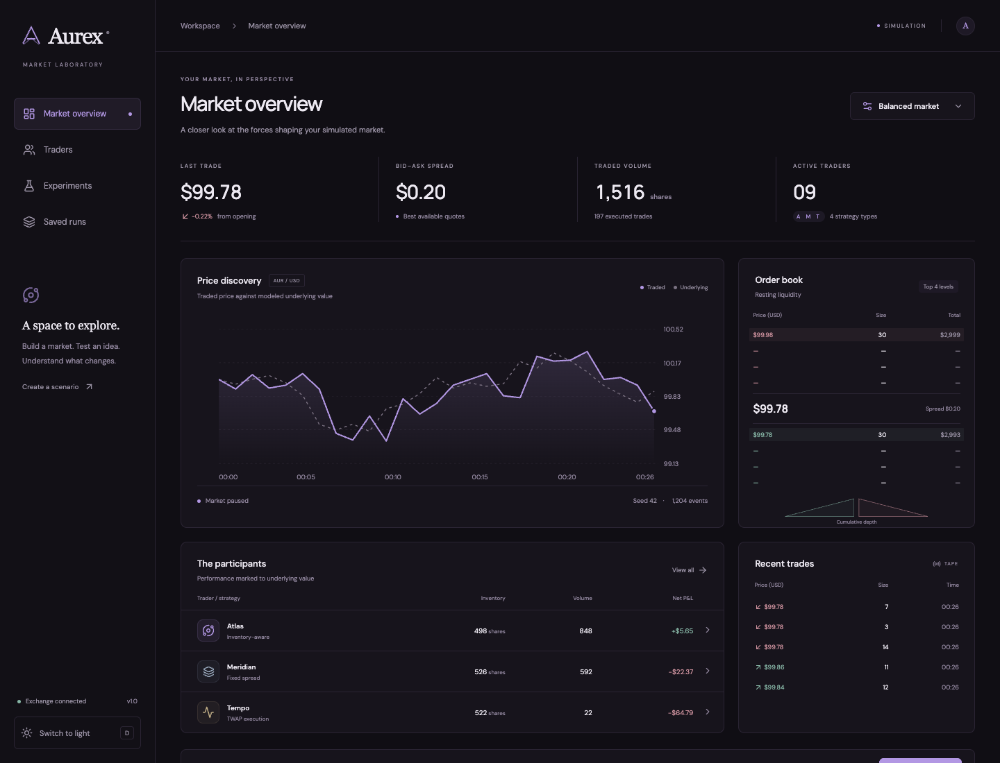
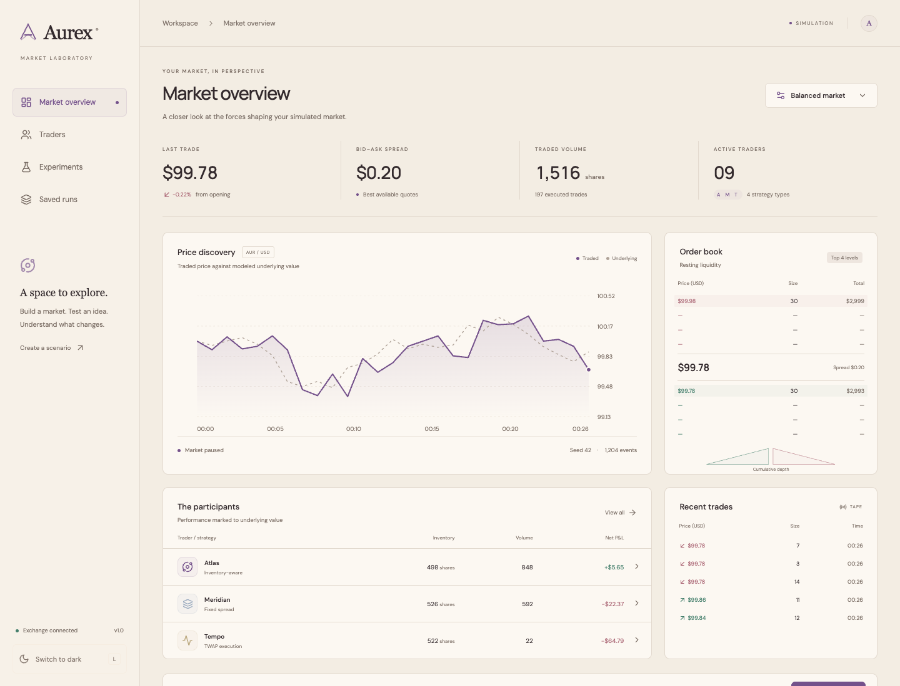
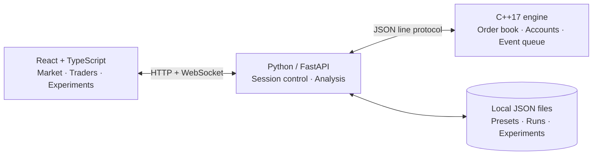

<div align="center">

# Aurex

**A market laboratory for studying automated trading.**

A C++ exchange engine, reproducible experiments, and a minimal React interface.

[](https://github.com/OorjitSethi/aurex/actions/workflows/ci.yml)


[Quick start](#quick-start) · [Features](#features) · [Architecture](#architecture) · [Experiments](#experiments) · [Documentation](#documentation)

</div>



Aurex recreates an electronic market: traders submit orders, the exchange matches them, and strategies compete under changing value, demand, fees, and latency. Every displayed trade, quote, and account balance comes from the simulation engine.

The central experiment asks: **how does inventory-aware quoting change a market maker’s performance and risk compared with fixed-spread quoting?** The platform supports both interactive exploration and repeated, paired-seed comparisons.

> This is a local, single-user research prototype with fictional assets. It does not connect to a broker or execute real trades. Its results describe the modeled environment, not evidence of real-market profitability.

## Interface

The default theme uses near-black surfaces and muted violet accents. Light mode pairs warm beige and ivory with aubergine. The interface includes responsive layouts, keyboard-accessible controls, reduced-motion support, and locally remembered theme selection.

<details>
<summary><strong>View the light theme</strong></summary>



</details>

## Features

| Area | What is implemented |
| --- | --- |
| Exchange | Limit and market orders, price-time priority, resting-price execution, partial fills, indexed cancellations, and self-trade prevention |
| Accounting | Integer-cent prices/cash, integer shares, funded accounts, resource reservations, explicit fees, and conservation checks after every event |
| Simulation | Deterministic event ordering, seeded independent random streams, delayed observations and orders, volatility, directional pressure, and value shocks |
| Strategies | Fixed-spread market maker, inventory-aware market maker, background flow traders, and a gradual execution trader |
| Market view | Price/reference chart, order book, cumulative depth, recent trades, run/pause, single-event stepping, and speed controls |
| Trader inspection | Quotes, holdings, cash, reservations, recent decisions, fees, realized/unrealized gains, drawdown, and execution quality |
| Experiments | 5–200 paired seeds, distributions, approximate confidence intervals, paired differences, and risk/cost comparisons |
| Reproducibility | Saved presets, automatic completed-run saving, manual checkpoints, visual replay, exact command journals, and JSON exports |

## Quick start

### Requirements

- **macOS or Linux**; use WSL on Windows.
- **Python 3.10+** with virtual-environment support.
- **Node.js 20.19+ or 22.12+** and npm.
- A **C++17 compiler** (`clang++` or `g++`, available as `c++`).

On macOS, install the compiler tools with `xcode-select --install` if needed. On Ubuntu/Debian, the system packages are `build-essential`, `python3`, and `python3-venv`; install a supported Node.js release separately.

```sh
git clone https://github.com/OorjitSethi/aurex.git
cd aurex
./start.sh
```

Open **http://127.0.0.1:8787**.

The launcher creates the Python environment, installs pinned dependencies, builds and tests the C++ engine, installs the frontend from its lockfile, builds it, and starts the local server. Keep the terminal open; press **Ctrl+C** to stop. macOS users can also double-click **`Launch.command`** after cloning.

Internet access is needed for first-time dependency installation and optional Google Fonts loading. The simulation itself runs locally; fonts have system fallbacks.

### First session

1. Choose **Run market** to start the default seeded scenario.
2. Pause and use **Advance one event** to inspect individual changes.
3. Select **Atlas**, **Meridian**, or **Tempo** to inspect its account and decisions.
4. Open the scenario panel to change volatility, fees, latency, population, or strategy. Applying a scenario resets the active session; save your current run first if needed.
5. Open **Experiments** and run a paired comparison.
6. Save or export a run, then revisit it through **Saved runs**.

A fresh clone starts with an empty local run library. The screenshots show an actual simulated session, not preloaded market data.

## Architecture



The C++ engine runs independently of the interface. The Python service manages the interactive process, streams display snapshots, launches headless runs for experiments, and stores results. Browser rendering does not determine event ordering. Playback speed changes the event budget per display update; it is not a guaranteed ratio to wall-clock time.

### Repository layout

```text
Aurex/
├── engine/                 # Matching, accounts, event scheduler, strategies
│   └── vendor/             # nlohmann/json header and license
├── backend/                # FastAPI service and pinned Python dependencies
├── web/                    # React/TypeScript frontend and npm lockfile
├── tests/                  # C++ correctness and Python integration tests
├── scripts/                # Engine build and exact-replay verification
├── examples/               # Ready-to-run scenario configurations
├── docs/                   # Screenshots, model notes, API, original brief
├── data/                   # Generated local runs; ignored by Git
├── .github/                # CI and issue/PR templates
├── start.sh                # Local setup and launch
└── Launch.command          # macOS launcher
```

## Experiments

Each pair evaluates Atlas once with fixed-spread quoting and once with inventory-aware quoting. Meridian remains a fixed-spread counterparty. Both runs share the exogenous value seed and the background traders’ random streams. Different strategy actions can still change executions, account constraints, and the resulting market.

The results view reports:

- P&L distributions with common histogram bins.
- Mean, median, and worst P&L.
- Approximate 95% intervals for each mean and for the **within-seed difference**.
- Average drawdown, fees, and peak inventory.
- Per-seed results and configuration in downloadable JSON.

Intervals use `mean ± 1.96 × sample standard error`; small batches are exploratory. The baseline strategy parameters are documented rather than fitted to the displayed results. See [model assumptions and accounting](docs/MODEL.md) for the value process, timing, funding, fees, valuation, and statistical limits.

### Run the engine without the interface

```sh
./scripts/build-engine.sh
./build/aurex-engine --run < examples/balanced.json > /tmp/aurex-result.json
```

Try [balanced](examples/balanced.json), [buying pressure](examples/buying-pressure.json), or [value shock](examples/value-shock.json). These are simulation inputs, not recorded research conclusions. Use validated configurations within the limits listed in the [API guide](docs/API.md).

## Saving and reproducibility

Presets, runs, and experiments are saved as JSON under `data/`. The directory is created automatically. Generated files are excluded from Git.

A saved interactive run includes its engine version, configuration, final snapshot, display frames, recorded value shocks, and exact engine command journal. Visual replay uses display snapshots; long runs may thin those frames to bound storage. The command journal retains the sequence needed to reproduce timestamp ties and mid-run interventions.

```sh
.venv/bin/python scripts/reproduce.py data/run-YOUR_ID.json
# Or use the JSON downloaded by the Export button.
```

Exact replay is checked against the **same engine build**; floating-point value-process calculations are not guaranteed bit-identical across platforms or compiler versions. Restarting the server clears the active in-memory session, but previously saved files remain available.

## Development

Install dependencies and build once with `./start.sh`. For frontend development, stop that process and use two terminals:

```sh
# Terminal 1: backend
.venv/bin/python -m uvicorn backend.app:app --host 127.0.0.1 --port 8787

# Terminal 2: frontend, with hot reload
npm --prefix web run dev
```

Open **http://127.0.0.1:5173**. Vite forwards HTTP and WebSocket requests to the backend. FastAPI’s interactive API reference is available at **http://127.0.0.1:8787/docs**.

## Tests

```sh
./scripts/build-engine.sh
.venv/bin/python -m unittest discover -s tests -p 'test_*.py'
npm --prefix web run build
```

The suite includes **7 C++ test groups and 6 Python integration tests**:

- Price-time priority, partial fills, multi-price execution, cancellations, empty books, reservations, fees, and self-trade prevention.
- Conservation and P&L decomposition across multiple conditions.
- Repeated-seed equality and identical exogenous value paths across strategies.
- Live-step/batch equivalence and no premature effect from future shocks.
- API validation, controls, WebSocket snapshots, and exact journal replay after an injected shock.

GitHub Actions runs the engine tests, integration tests, headless example, and production frontend build on macOS and Linux. Manual browser verification also covered both themes, scenario editing, saved replay, trader inspection, paired experiments, and mobile overflow; those browser checks are not part of CI.

## Documentation

- [Model assumptions and accounting](docs/MODEL.md)
- [HTTP, WebSocket, and engine interfaces](docs/API.md)
- [Original project brief](docs/PROJECT_BRIEF.md) — design context; the README describes the implemented scope
- [Contributing and local checks](CONTRIBUTING.md)
- [Security and deployment boundary](SECURITY.md)
- [Third-party notices](THIRD_PARTY_NOTICES.md)
- [Release notes](CHANGELOG.md)

## Project scope

Aurex currently models one asset with fixed initial endowments and simple baseline strategies. It has no broker integration, authentication, multi-user isolation, auctions, hidden liquidity, borrowing, or margin. Accounts start with 500 shares, so P&L and drawdown include exposure from that initial inventory. Execution can finish below its target when time, liquidity, or funding is insufficient.

The backend is intended to bind to loopback for local use. Hosting it for other users requires additional application and operational work.

## Copyright

Copyright © 2026 Oorjit Sethi. All rights reserved for original project code unless separately licensed. Third-party components retain their respective licenses; see [third-party notices](THIRD_PARTY_NOTICES.md).
